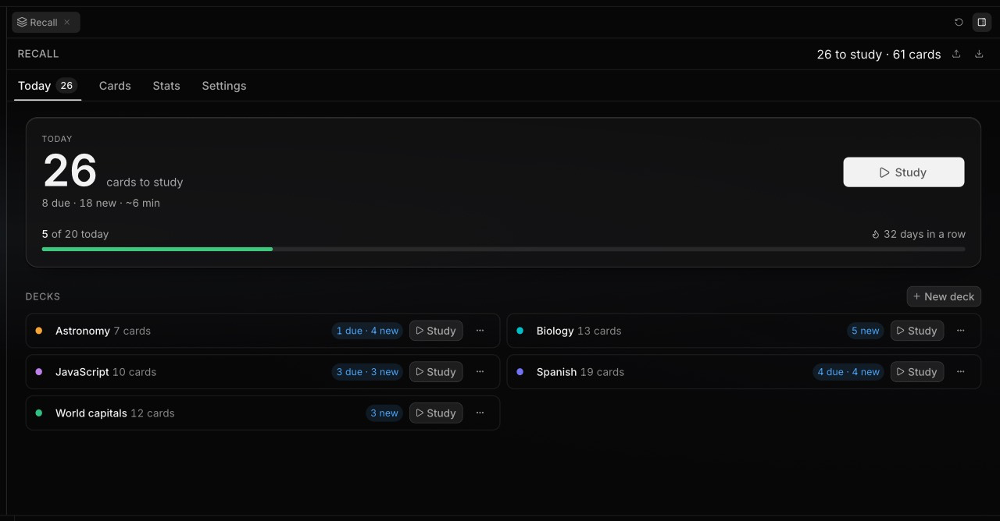
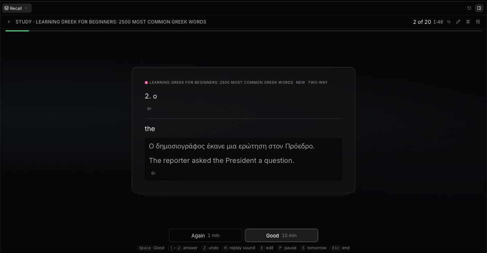
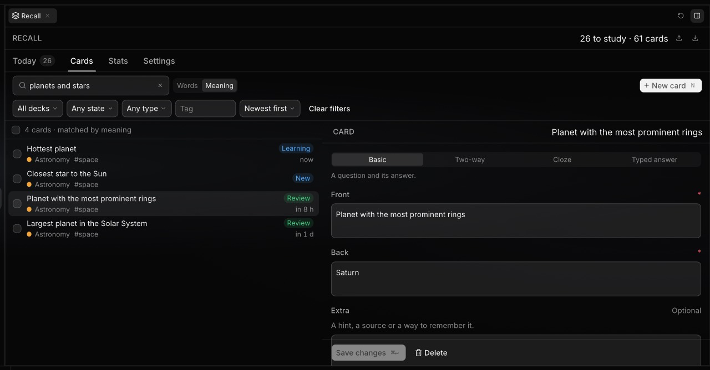
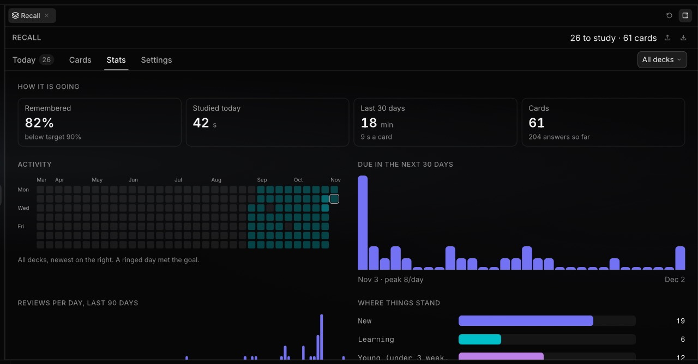

# Recall

Spaced-repetition flashcards for Localix. Study on a calm, keyboard-first screen, and let the agent
in your chat make cards from your notes and files, quiz you, explain what you missed and keep your
decks tidy. Recall schedules every review with FSRS, so you see a card just before you would forget
it, and no sooner.

## What it does

- **Study in one tap.** Today shows how many cards are due, about how long that takes, your daily
  goal and your streak. Press Study and answer; the next card is already waiting.
- **Four tabs.** Today (what to study and your decks), Cards (search, filter, edit, move, tag, pause
  and review in bulk), Stats (activity over the year, a forecast, retention and your hardest cards)
  and Settings (new cards per day, how much you want to remember, answer buttons, playing sounds by
  themselves, your goal).
- **Four kinds of card.** Basic, reversed (both directions), cloze (`The capital of France is
  {{c1::Paris}}`) and typed (you write the answer).
- **Drafts you approve.** Cards the agent makes arrive as drafts. You read them, accept the ones you
  want and discard the rest; nothing is added to your study silently.
- **Decks without friction.** Cards with no deck wait in the Inbox, where Recall suggests a deck and
  tags for you to accept. It also warns when a new card looks like one you already have.
- **Import and export.** Bring your Anki decks, spreadsheets and Markdown notes; take a backup out
  whenever you like. An Anki deck keeps what it shows, sound included.
- **Sound.** A card can play its sounds: a button on the card, and a setting to play them by
  themselves while you study. Press R to hear the side in view again.
- **Anki files open in Localix.** Open a `.apkg` or `.colpkg` from the file list or a chat and Recall
  shows what is inside (a few cards, the decks, what you already have) with an Import button.

## Ask the agent

Recall gives the agent tools to read and change your cards, so you can work in plain language:

- "Make flashcards from this chapter" (attach a file or paste the text).
- "Quiz me on Spanish vocabulary, five cards."
- "I keep missing the mitochondria card. Explain it and rewrite it so it sticks."
- "Import `~/Downloads/biology.apkg` and keep my Anki progress."
- "How am I doing this week? Which deck is hardest?"

The agent makes cards as drafts unless you ask for them ready, and it never deletes cards, discards
drafts or resets progress unless you name them. When the Recall tab is open, "this card" means the
card you are looking at.

## Keyboard shortcuts

While studying:

| Key                 | Action                                                        |
| ------------------- | ------------------------------------------------------------- |
| Space or Enter      | Show the answer, then give the suggested answer (Good)        |
| 1 – 4               | Answer: Again, Hard, Good, Easy (1 and 2 with two buttons)    |
| R                   | Play the sound of the side in view again (cards with sound)   |
| Z                   | Undo the last answer                                          |
| E                   | Edit this card                                                |
| P                   | Pause this card                                               |
| S                   | Skip this card until tomorrow                                 |
| Esc                 | End the session                                               |

## Import and export

| Format            | Files                                  | Notes                                                                         |
| ----------------- | -------------------------------------- | ----------------------------------------------------------------------------- |
| Anki              | `.apkg`, `.colpkg`                     | Cards as they look in Anki, with pictures and sounds; optionally keep your progress. |
| Spreadsheet       | `.csv`, `.tsv`, `.txt`                 | Front, back, optional tags and deck; header and delimiter are detected.       |
| Markdown          | `.md`, `.markdown`, `.txt`             | `Q:` and `A:` blocks, `C:` for cloze, `---` between cards, `# Deck` headings. |
| Recall backup     | `.json`                                | Cards, decks, settings and your whole review history.                         |

Limits: a text, CSV or JSON file up to 50 MB; an Anki package up to 512 MB that may expand to 500 MB
in total, with no single picture or sound inside it over 50 MB. An import first shows a preview
(counts, decks, duplicates, warnings) and only then adds the cards, as drafts or ready. Looking
inside a file stores nothing: its pictures and sounds are stored only when you import. Export writes a
JSON backup, CSV or Markdown.

### Anki decks

Recall reads a deck the way Anki shows it: it renders each note type's card templates, so a deck made
of several fields (a word, its meaning, examples, audio) becomes real cards rather than its first two
fields. One template makes a basic card (a typed one when the question asks you to type). Two
templates that mirror each other make one two-way card, and what the answers add (examples, audio) goes
in its extra. A cloze note type uses the field its template shows. A note type that is none of these
makes one basic card per Anki card, each keeping its own progress, and Recall says so.

Sounds (`mp3`, `m4a`, `aac`, `ogg`, `oga`, `opus`, `wav`, `flac`) come in with the cards and play from
a button on the card. A clip that sits on nearly every card of a deck (a few seconds of silence, say)
is decoration, so Recall leaves it out and says so in a short note (notes are information; warnings are for what was lost or skipped). A JSON backup holds neither pictures nor
sounds; export to CSV or Markdown leaves sounds out.

### Opening an Anki file

A `.apkg` or `.colpkg` opens in Localix as a tab of its own, with the deck's name, its size, a look at
five cards, the decks the cards would go to (new, or already in Recall) and how many you already have.
Choose where the cards go, whether they are ready to study or drafts to look over first, whether to
keep your Anki progress and whether to skip cards you already have, then press Import. When it is
done, **Open in Recall** shows the cards and **Study now** starts a session on them. If you do not
have Recall yet, the Store offers it for such a file.

## How it works

Your reviews are the truth. Every answer is stored in a review log, and a card's memory state is
derived from it, so changing how scheduling works replays the log instead of migrating data. Cards
are held in a local SQLite database, paged and indexed so a collection of tens of thousands stays
fast. Each write updates every open screen at once, with no polling. Each day starts at 4 am
(configurable), so a late-night session counts toward the day you started it.

A session shows learning cards first, then reviews (the most forgotten first), then new cards up to
the day's limit. Paused cards, drafts, cards skipped until tomorrow and the siblings of a card you
answered today stay out of it. A card missed eight times is marked as a hard card, and the agent can
offer to rewrite it.

## Privacy

Everything stays on your computer, in the app's own data folder. Recall makes no network requests
and has no account. Two optional features borrow the models you already use in Localix: suggesting a
deck for Inbox cards and spotting similar cards use embeddings, and checking a typed answer (off by
default) asks your chat model. Nothing leaves your computer for any other purpose.

## Credits

- [ts-fsrs](https://github.com/open-spaced-repetition/ts-fsrs) (MIT) implements the FSRS scheduler.
- [fflate](https://github.com/101arrowz/fflate) (MIT) reads Anki's zip packages.

## Screenshots

The store shows the images listed in `.localix-mini-app/mini-app.json`: `screenshots/today.png`,
`study.png`, `cards.png` and `stats.png`, each 1280 x 668 pixels: Recall's panel maximized in a
1280-pixel-wide Localix window (PNG; the store takes PNG, JPG or WebP up to 5 MB each, at most 10).
